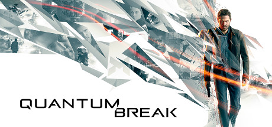

**Quantum Break is a time-manipulation third-person shooter where you play both as the hero with time powers and experience the story through live-action TV episodes. Features stunning particle effects, story-driven combat, and a unique media hybrid format.**

---

## 📖 About

Quantum Break is a time-manipulation third-person shooter where you play both as the hero with time powers and experience the story through live-action TV episodes. Features stunning particle effects, story-driven combat, and a unique media hybrid format.

## ⚠️ Problems Without Trainer

| Problem | Status |
|---------|--------|
| **Time Power Energy** — Running out of chronon energy mid-fight removes all defensive options | ✅ Solved |
| **Cover Dependency** — Late sections heavily punish players who don't use time powers defensively | ✅ Solved |
| **Junction Choices** — Story junction decisions affect live-action episodes but not gameplay much | ✅ Solved |
| **PC Port Quality** — Windows Store exclusivity initially caused technical issues | ✅ Solved |

## ✅ Solution

The **Quantum Break Trainer** solves all these issues by giving you complete control over the game.

## 🎯 Full Feature List

- Unlimited Resources
- God Mode / Invincibility
- Instant Skill Cooldown
- One-Hit Kill
- Freeze Game Timer
- Unlock All Items & Achievements
- Custom Speed Multiplier
- Save State Anywhere

## 🚀 Quick Start

1. **Disable Windows Defender** temporarily (trainer may trigger false positive)
2. Download the trainer from the button above
3. Launch Quantum Break
4. Run the trainer as Administrator
5. Activate desired cheats with hotkeys

## 💎 Free vs Paid

| Feature | Free | Pro |
|---------|------|-----|
| Basic God Mode | ✅ | ✅ |
| Unlimited Resources | ✅ | ✅ |
| All Advanced Cheats | ❌ | ✅ |
| Auto-Updates | ❌ | ✅ |
| Priority Support | ❌ | ✅ |

## 💻 Requirements

- Windows 10/11 (64-bit)
- Quantum Break (any version)
- .NET Framework 4.8+
- DirectX 11+

## 🍎 macOS

macOS users can use our alternative tool:

## ⚖️ Legal

This trainer is for educational and single-player use only. Use responsibly.

---

